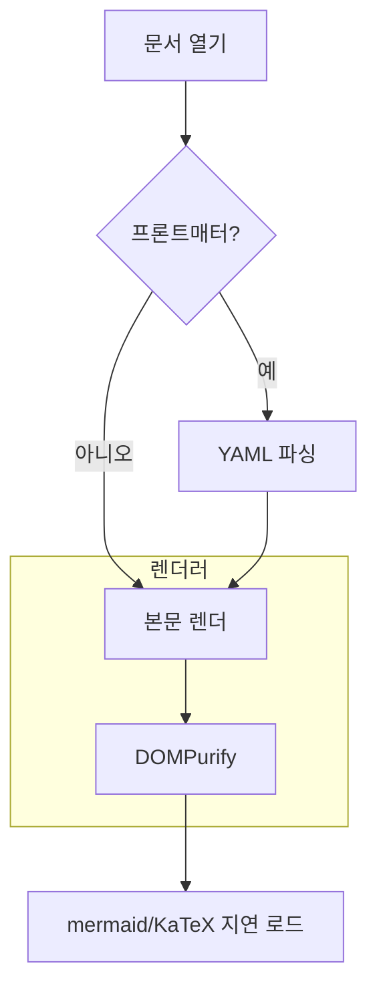
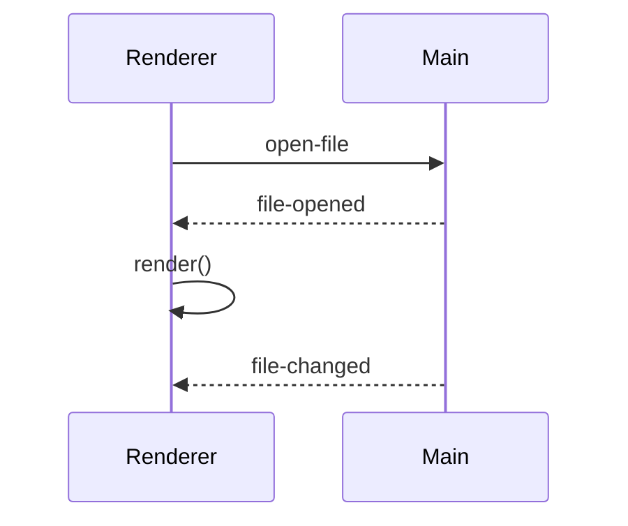
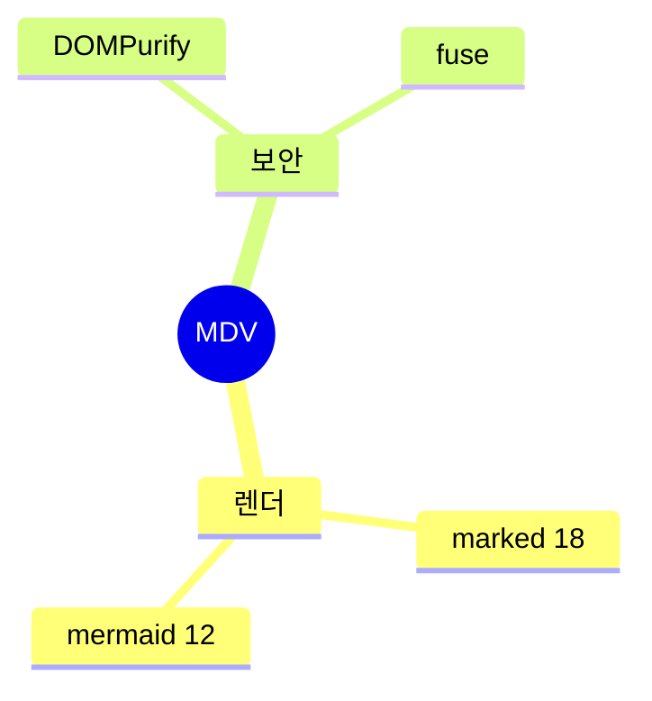
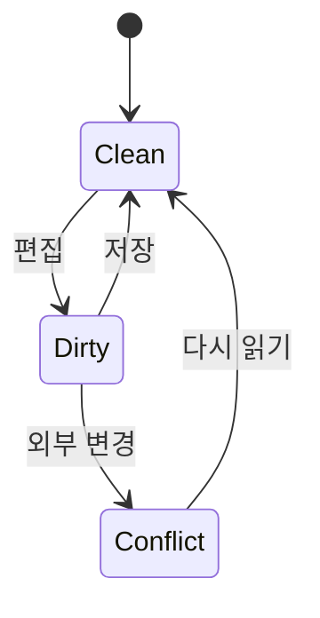
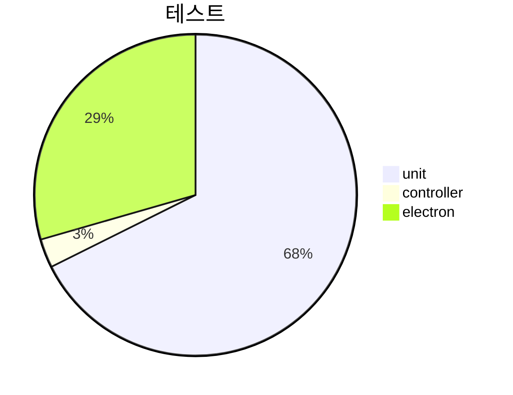
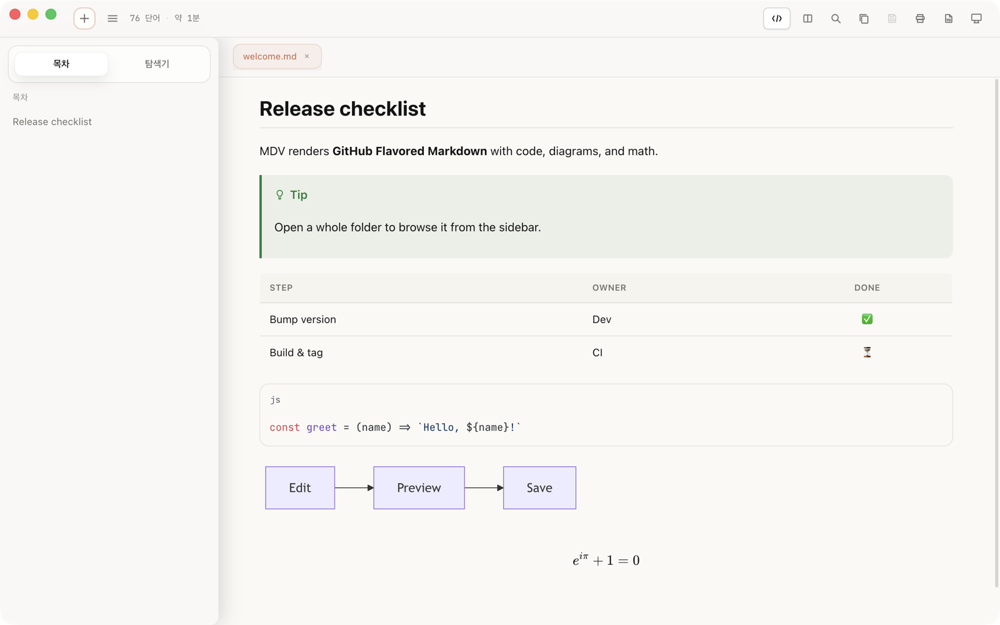

# MDV 릴리스 전 수동 확인

이 문서 하나를 MDV로 열어 위에서 아래로 보면서 확인한다. 각 절의 **기대 결과**와 실제 화면을 비교한다.
체크박스는 표시용이라 눌러도 저장되지 않는다.

> [!TIP]
> 확인 순서: 미리보기 → ⌘U(소스 모드) 왕복 → 분할 보기 → 테마 전환(라이트/다크) → 인쇄(PDF로 저장) → 언어 전환.

## 1. 앱 전체

- [ ] 메뉴 막대의 앱 이름이 대문자 **MDV**로 보인다(예전에는 소문자 `mdv`).
- [ ] 위쪽 프론트매터 카드가 접힌 카드로 보이고, 펼치면 키가 열, 값이 한 행인 가로 표로 보인다.
- [ ] 왼쪽 목차에 이 문서의 절들이 보이고, 스크롤하면 지금 읽는 절이 강조된다.
- [ ] **언어**: 시스템 설정 → 일반 → 언어 및 지역 → 앱 → MDV를 English로 바꾸고 다시 열면 메뉴·버튼·안내가 영어로 나온다. 한국어로 되돌리면 한국어로 나온다.

## 2. 표와 목록

| 왼쪽 정렬 | 가운데 정렬 | 오른쪽 정렬 |
|:---|:---:|---:|
| 사과 | 3 | 1,200원 |
| 아주 긴 텍스트가 들어간 셀은 줄바꿈되어야 하고 표가 본문 폭을 넘지 않아야 한다 | `inline-code-in-a-table-cell-that-is-quite-long` | 99,000원 |

- [ ] 표의 세 열이 각각 왼쪽·가운데·오른쪽으로 정렬된다.
- [ ] 긴 셀과 긴 인라인 코드가 표를 본문 밖으로 밀어내지 않는다.

작업 목록과 중첩 목록:

- [x] 완료된 항목
- [ ] 안 된 항목
  - 중첩 항목 1
    - 더 깊은 항목
  - 중첩 항목 2
1. 번호 목록 첫째
2. 번호 목록 둘째
   - 번호 목록 안의 글머리표

## 3. Alert 다섯 종류

> [!NOTE]
> NOTE: 파란 계열 아이콘과 제목.

> [!TIP]
> TIP: 초록 계열.

> [!IMPORTANT]
> IMPORTANT: 보라 계열.

> [!WARNING]
> WARNING: 노랑 계열.

> [!CAUTION]
> CAUTION: 빨강 계열.

> 평범한 인용문. Alert가 아니므로 아이콘이 없어야 한다.

- [ ] 다섯 Alert가 각자 다른 색과 아이콘, 제목으로 보이고 마지막 인용문은 평범하다.

## 4. 강조와 취소선

- **굵게**, *기울임*, ***굵은 기울임***, `인라인 코드`
- ~~두 물결 취소선~~과 ~한 물결 취소선~
- 단어 안의 물결 a~b~c는 취소선이 **아니어야** 한다.
- 이스케이프한 물결 \~글자 그대로\~

- [ ] 위 네 줄이 설명대로 보인다.

## 5. 코드 블록

언어가 있는 펜스. 오른쪽 위 복사 버튼을 누르면 "코드 복사됨"이 뜨고, 붙여 넣으면 아래 세 줄 그대로다:

```javascript
// 복사 버튼 확인용
const answer = 42
console.log(`answer is ${answer}`)
```

언어가 없는 펜스. 언어 라벨 줄이 없어야 한다:

```
plain text block
second line
```

아주 긴 한 줄. 블록 안에서 가로로 스크롤되고 복사 버튼과 겹치지 않아야 한다:

```bash
echo "this is a deliberately very long single line of code that should scroll horizontally inside the code block instead of widening the page or hiding under the copy button"
```

들여쓴 코드 블록. 복사했을 때 끝에 빈 줄이 붙지 않아야 한다:

    indented line one
    indented line two

- [ ] 네 블록이 설명대로 보이고, 복사 결과가 화면과 같다.

## 6. 수식(KaTeX)

```math
\int_0^1 x^2\,dx = \frac{1}{3}
```

```latex
e^{i\pi} + 1 = 0
```

본문 속 $x^2$와 $$y$$는 수식이 아니라 글자 그대로 보여야 한다(알려진 제한사항).

- [ ] 두 펜스가 수식으로 렌더링되고, 본문 속 `$…$`는 글자 그대로다.

## 7. 다이어그램(mermaid 12)

라이트와 다크 둘 다에서 본다. 테마를 바꾸면 다이어그램도 다시 그려진다. mermaid 12부터는 배치가 11과 다르다(ELK). 다이어그램이 잘리거나 겹치지 않는지만 본다.











- [ ] 다섯 다이어그램이 모두 그려진다(오류 그림 없음).
- [ ] 라이트 ↔ 다크 전환 때 다이어그램 색이 테마를 따라 바뀐다.
- [ ] ⌘U로 소스 모드에 갔다 돌아와도 다이어그램 크기가 그대로다(작게 쪼그라들지 않음).
- [ ] 다크 테마에서 인쇄(PDF로 저장)하면 다이어그램이 밝은 색으로 나온다. 인쇄 뒤 화면은 다시 다크다.

## 8. 링크와 이미지

- 외부 링크: [GitHub의 MDV](https://github.com/oiysful/MDV). 누르면 기본 브라우저로 열린다.
- 문서 안 앵커: [5. 코드 블록으로 이동](#5-코드-블록)
- 다른 로컬 파일: [README](../../README.md). 누르면 MDV 탭으로 열린다.

로컬 이미지(상대 경로):



- [ ] 세 링크가 설명대로 동작하고, 스크린샷 이미지가 보인다.

## 9. marked 18로 바뀐 동작

문단 바로 다음 줄의 코드 펜스. 코드 블록으로 보여야 하고, 아래 `---`가 제목으로 바뀌면 안 된다:
```yaml
---
name: example
---
```

**Exit when ambiguity <= 20%** (이 문장 앞부분이 굵게 보여야 한다. 9.1.6에서는 별표가 그대로 보였다)

백틱이 든 코드 스팬 뒤의 굵게: `x``y` **굵게여야 함** `c`

숫자 참조: &#38;amp; 는 `&amp;`로 보여야 한다.

<Agent_Prompt> 밑줄이 든 태그 모양 텍스트는 이제 글자 그대로 보인다(예전에는 사라졌다).

**알려진 한계 두 가지(고장이 아님, README에 적힘):**

- **완료 ✅**다 ← 별표가 그대로 보인다. 기호로 끝나는 굵게 뒤에 바로 글자가 붙은 경우다.
- **완료**✅다 ← 우회한 쓰기. 굵게로 보인다.

목록 안 이중 줄바꿈(R4). 아래 항목에서 `c`와 `e` 사이에 빈 줄이 하나 더 보이면 알려진 한계 그대로다:

- a
      c
  e

- [ ] 위 설명이 모두 맞다.

## 10. 보안 수정 확인

문서에 직접 쓴 HTML의 `class`와 `style`은 지워진다. 아래 글자가 **빨간색이면 안 된다**:

<span style="color: red; font-size: 24px">빨간색·큰 글씨면 안 되는 문장</span>

이미지의 `width`는 유지된다. 아래 이미지는 작게(120px) 보여야 한다:


문서가 만든 가짜 복사 버튼. 눌러도 **아무것도 복사되지 않아야 한다**(토스트 없음):

<button data-command="copyCode" data-command-element="true">가짜 복사 버튼</button>

- [ ] 빨간 글씨가 아니고, 이미지는 작고, 가짜 버튼은 아무 일도 하지 않는다.

## 11. 읽던 위치 유지(⌘U, 분할 보기)

1. 이 절이 화면 맨 위에 오도록 스크롤한다.
2. ⌘U로 소스 모드에 들어갔다가 다시 ⌘U로 나온다. 이 절 근처에 그대로 있어야 한다.
3. 분할 보기를 켠다. 왼쪽 소스와 오른쪽 미리보기가 이 절 근처를 보여야 한다. 끄면 다시 이 절 근처다.
4. 분할 보기에서 ⌘U로 나와도 이 절 근처다.

- [ ] 네 단계 모두 읽던 위치가 유지된다.

## 12. 검색

⌘F로 `확인용`을 검색한다. 미리보기에서 일치 항목이 강조되고, Enter와 Shift+Enter로 앞뒤로 이동한다. 소스 모드에서도 같다.
한글을 입력하고 Enter를 눌러도 마지막 글자가 두 번 입력되지 않는다.

- [ ] 검색 강조와 이동이 미리보기와 소스 모드 둘 다에서 된다.

## 13. 스크롤용 긴 절

목차 강조가 절을 따라 바뀌는지 보려고 둔 절이다. 천천히 스크롤하면서 왼쪽 목차의 강조가 13 → 14 → 15로 넘어가는지 본다.

Lorem ipsum 대신 한국어 문장을 반복한다. 이 문장은 스크롤 길이를 만들기 위한 것이다. 이 문장은 스크롤 길이를 만들기 위한 것이다. 이 문장은 스크롤 길이를 만들기 위한 것이다. 이 문장은 스크롤 길이를 만들기 위한 것이다. 이 문장은 스크롤 길이를 만들기 위한 것이다.

이 문장은 스크롤 길이를 만들기 위한 것이다. 이 문장은 스크롤 길이를 만들기 위한 것이다. 이 문장은 스크롤 길이를 만들기 위한 것이다. 이 문장은 스크롤 길이를 만들기 위한 것이다. 이 문장은 스크롤 길이를 만들기 위한 것이다.

이 문장은 스크롤 길이를 만들기 위한 것이다. 이 문장은 스크롤 길이를 만들기 위한 것이다. 이 문장은 스크롤 길이를 만들기 위한 것이다. 이 문장은 스크롤 길이를 만들기 위한 것이다. 이 문장은 스크롤 길이를 만들기 위한 것이다.

## 14. 스크롤용 두 번째 절

이 문장은 스크롤 길이를 만들기 위한 것이다. 이 문장은 스크롤 길이를 만들기 위한 것이다. 이 문장은 스크롤 길이를 만들기 위한 것이다. 이 문장은 스크롤 길이를 만들기 위한 것이다. 이 문장은 스크롤 길이를 만들기 위한 것이다.

이 문장은 스크롤 길이를 만들기 위한 것이다. 이 문장은 스크롤 길이를 만들기 위한 것이다. 이 문장은 스크롤 길이를 만들기 위한 것이다. 이 문장은 스크롤 길이를 만들기 위한 것이다. 이 문장은 스크롤 길이를 만들기 위한 것이다.

## 15. 마지막 절

여기까지 왔으면 목차 마지막 항목이 강조되어 있어야 한다.

- [ ] 목차 강조가 절을 따라 바뀌었고, 맨 끝에서 마지막 항목이 강조된다.
